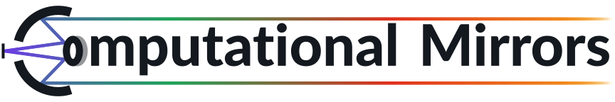
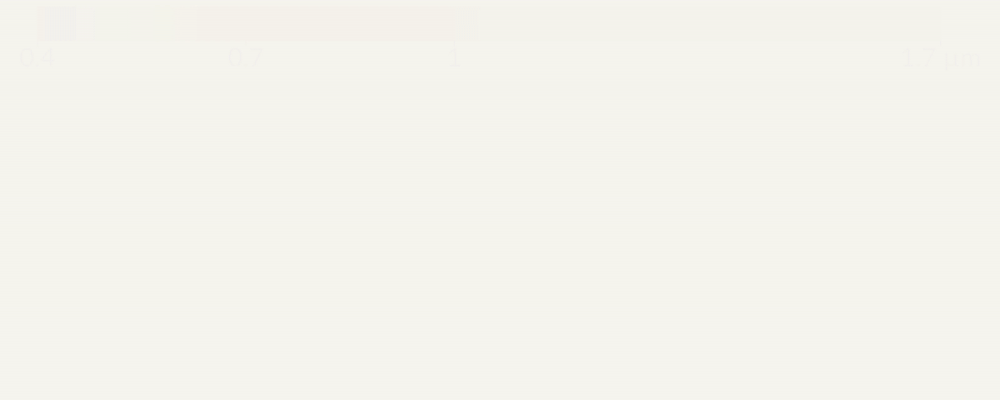
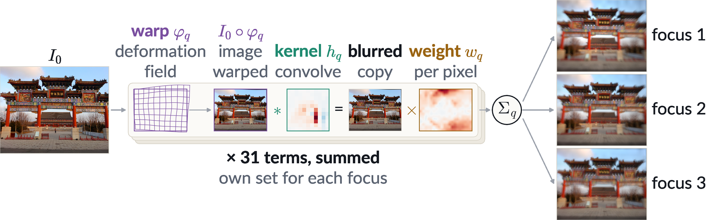

<p align="center">
  <picture>
    <source media="(prefers-color-scheme: dark)" srcset="assets/title_dark.svg">
    
  </picture>
</p>

<p align="center"></p>
<p align="center"><b>Very Broadband Imaging with Simple Mirror Optics</b></p>

A mirror has no chromatic aberration: one simple mirror objective focuses every band at the same place, from visible
light to the short-wave infrared (0.4–1.7 µm). Above: one scene in three bands, seen by a VIS–SWIR sensor behind a
mirror objective. The price is a blur that changes across the field. We calibrate a spatially varying PSF model of the
camera once, then deconvolve every capture with it.

**RGB + NIR + SWIR:** V. Saragadam, N. Nezakati, A. Roy-Chowdhury, V. Boominathan, "Broadband Full Field of View
Imaging with Computational Mirrors," ECCV 2026 (Oral). [arXiv:2605.00029](https://arxiv.org/abs/2605.00029)

**B-spline version:** A. Kayabasi, N. Nezakati, A. Roy-Chowdhury, V. Boominathan, V. Saragadam, "Extreme Broadband
Imaging with Mirrors," Asilomar 2026.

- `real/`: visible, NIR and SWIR camera
- `modules/`: PSF models (`linear.py`), PnP solver. The DRUNet weights `modules/drunet_gray.pth` are not in git:
  get them from [KAIR](https://github.com/cszn/KAIR).

## Forward model

<p align="center"></p>

The capture is a sum of $Q$ terms. Each term warps the scene with a smooth B-spline deformation, blurs it with one
kernel and scales it with a weight map that varies smoothly across the field:

$$I = \sum_{q=1}^{Q} w_q \odot \left( h_q * \left( I_0 \circ \varphi_q \right) \right)$$

- $I_0$: sharp scene, $I$: capture; $\varphi_q$: warp, $h_q$: kernel, $w_q$: per-pixel weight; $*$: convolution,
  $\odot$: pixel-wise product.
- Warps, kernels and weights are learned from calibration captures: $Q = 31$ terms for each image of the focal stack,
  each image with its own set. The figure shows one learned term (warp magnified 3 times) and the three focus images
  it helps form.
- `psfmodel = 'affineplus'` (SeidelConv, the baseline) is the same sum with affine warps.

## Setup

You need Python 3.11 and a CUDA GPU. We tested torch 2.9.1, numpy 1.26.4, kornia 0.8.2 and hf-deepali 0.6.5.

```bash
pip install torch torchvision "numpy<2" scipy opencv-python scikit-image matplotlib pyyaml tqdm kornia hf-deepali threadpoolctl
export PYTHONPATH=/path/to/computational-mirror
```

## Data

The data is not in git. Keep it in one folder, `<DATA>` below, organised as:

```
<DATA>/
└── visible/
    ├── <calib_session>/          calibration captures of one camera setup
    │   ├── aruco25.mat           ArUco board           -> homography
    │   ├── autofocus4.mat        autofocus target      -> focus index
    │   ├── pdisk_16_<i>.mat      random-disk scenes    -> PSF training pairs (i = 1 ... 10)
    │   ├── black.mat             dark frame
    │   └── vignetting.mat        flat frame
    ├── <test_session>/           test captures <name>.mat (charts; scenes through blue, green, red, NIR and SWIR
    │                             filters), with their own black.mat and vignetting.mat
    └── model/                    final PSF model multi<nfocus>_<psfmodel>_31_11_params.pth
```

Session and scene names are free; the scripts read the file names above.

- Visible captures (`.mat`): the focal stack `imstack` (H x W x focus positions) and its `exposure`. The random-disk
  scenes also hold the displayed pattern `gt` and the dark level `offset_single`. `real_calibration.py` and
  `real_gen_training.py` write `pycalib.mat` and `pytraining_multi<nfocus>.mat` into `<calib_session>/`, so work on
  a copy.

Our data: [calibration_data on Google Drive](https://drive.google.com/drive/folders/1ybdGNo-bA6wvIN2ZRmrQryXyfyxY2aXw?usp=drive_link)
(private; ask us for access). It has the layout above (calibration session `2.19.calib` and the final model); its
`README.md` lists every file. On the lab workstation: `/mnt/mydisk/alper/calibration_data/`.

## Visible / NIR / SWIR (`real/`)

Settings are the variables at the top of each script's `__main__` block: `root = '<DATA>/visible'`, `session`
(`<calib_session>` or a test session), `nfocus`, `psfmodel`, ... The scripts open preview windows, so they need a
display.

```bash
cd real
python real_calibration.py        # homography, focus index   -> <root>/<calib>/pycalib.mat
python real_gen_training.py       # training pairs            -> <root>/<calib>/pytraining_multi<nfocus>.mat
python real_fit_multi_psf.py      # PSF model                 -> models/<calib>/multi<nfocus>_<psfmodel>_31_11_params.pth
python real_preprocess.py         # test captures             -> <saveroot>/<session>/<name>_multi<nfocus>.mat
python real_multi_pnp_deconv.py   # deconvolution             -> results/<session>/<name>/multi<nfocus>_<psfmodel>_31_11_pnp.png
```

- Use the same `nfocus` in every script. `nfocus = 3` is the 3-image focal stack of our main results.
- `psfmodel = 'bspline'` is our model; `'affineplus'` is the SeidelConv baseline.
- To run only the last step, copy the final model from `<DATA>/visible/model/` to `real/models/<calib_session>/`.

## Citation

If you use this work in your research, please cite:

```bibtex
@inproceedings{saragadam2026broadband,
  title={Broadband Full Field of View Imaging with Computational Mirrors},
  author={Saragadam, Vishwanath and Nezakati, Niki and Roy-Chowdhury, Amit and Boominathan, Vivek},
  booktitle={European Conference on Computer Vision},
  pages={592--608},
  year={2026},
  organization={Springer}
}
```

For the B-spline version:

```bibtex
@inproceedings{kayabasi2026extreme,
  title={Extreme Broadband Imaging with Mirrors},
  author={Kayabasi, Alper and Nezakati, Niki and Roy-Chowdhury, Amit and Boominathan, Vivek and Saragadam, Vishwanath},
  booktitle={Asilomar Conference on Signals, Systems, and Computers},
  year={2026}
}
```
